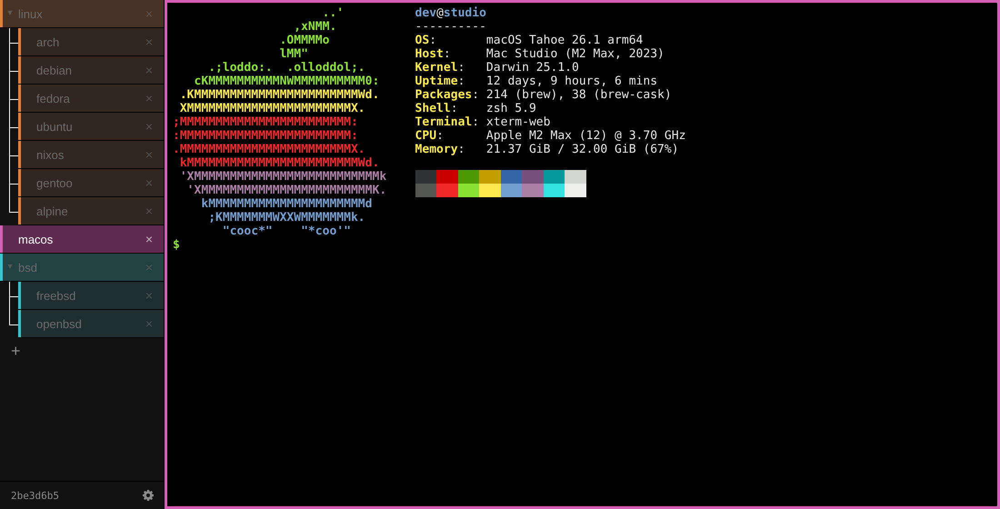

# xterm-web

Tabbed web terminal: xterm.js in the browser, one dtach session per tab.



```sh
npm ci                      # once: xterm.js, served to the browser from node_modules
./start.sh                  # http://<this-host>:7682 on every interface
BIND=127.0.0.1 ./start.sh   # localhost only (PORT=… to change the port)
ALLOW=10.0.0.2,10.0.0.3 ./start.sh   # only these clients (IPs or CIDRs); others get 403
```

`server.py` runs through a `uv run --script` shebang (aiohttp), and needs `dtach` on
`PATH`; it exits at startup if `dtach` is missing.

- Each tab is a `dtach -n sessions/<id>.sock $SHELL -l`. The server keeps one
  `dtach -a` client per tab and shares it with every browser viewing that tab.
- Tabs and their screens are global: every browser sees the same tabs (synced every
  2s), the same output live, and can type into them.
- A browser that opens a tab later, or reloads, is replayed the tab's last 512 KB of
  output — including output produced while nobody was watching.
- Closing the browser, or restarting the server, only detaches: shells keep running.
- One pty per tab means one size: the browser that last focused or resized the tab
  sets it.
- `exit` in a tab, or its × (after a confirmation), ends that session.
- Tabs can be dragged into a new order (mouse or pen), kept in `sessions/order.json`
  so every browser shares it.
- Tabs nest: drop a tab on the middle of another to put it inside, or near either end
  to put it before or after. Its nested tabs move with it. A tab with nested tabs has
  an arrow to fold them away (per browser), and nested tabs without a colour of their
  own take their parent's. Closing a tab moves the tabs nested in it up a level. The
  right-click menu can also nest, for touch screens, where tabs can't be dragged.
  In the side bar nested tabs are drawn as a tree (├ └ │); across the top they hang a
  step lower per level. The active tab's whole tree stays lit while other tabs dim.
- Tabs can be given a colour from the right-click menu (white and black included).
  A named tab without one gets an automatic colour from its name, distinct from the
  colours other tabs already show; tabs with the same name share it.
- The window title is the page's hostname (its first label, or a whole IP) followed by
  the active tab's name, so windows on different hosts are told apart.
- Selecting text with the mouse copies it to the clipboard. Over plain http this
  goes through `execCommand('copy')`, since `navigator.clipboard` needs https or
  localhost; copies requested by programs in the terminal (OSC 52) are ignored. On
  Linux and BSD the copy also fills PRIMARY, so middle-click pastes in Firefox.
- Emoji render at full width (Unicode 11 widths), and on macOS Option types the
  symbols the keyboard layout puts behind it (e.g. @ on Canadian French) rather than
  acting as Meta.
- The end of the tab bar shows the checkout's commit, marked with `*` when `server.py`
  has changed since the server started (a restart is needed; page changes only need a
  reload), and a ⚙ for settings: the tab bar down the left side (the default; on
  phones, the top) or across the top, and the font size. The side bar's width is set
  by dragging its edge (double-click it for the default). These are kept per browser
  (localStorage), unlike tabs, since they depend on the screen.
- From a local terminal: `dtach -a sessions/<id>.sock -r winch` (detach with `Ctrl \`).

## Keys

| keys                  | action                          |
| --------------------- | ------------------------------- |
| Alt+Shift+T           | new tab                         |
| Alt+Shift+N           | new tab nested in this one      |
| Alt+Shift+W           | close tab                       |
| Alt+Shift+R           | rename tab (or double-click it) |
| right-click tab       | colour, nesting                 |
| Alt+Shift+← / →       | previous / next                 |
| Alt+Shift+1…9         | go to tab N                     |
| Alt+Shift+PgUp / PgDn | move the tab past its neighbour |
| Alt+Shift+I / O       | nest in the tab above / unnest  |
| drag a tab            | move it                         |
| Ctrl+Shift+C          | copy the selection              |
| Ctrl+K                | clear the screen and scrollback |

## Services

`service/` has a launchd agent and a systemd user unit. Both set `BIND`/`PORT` and a
`PATH` with uv on it, and both stop only the server on a restart, never the tabs'
shells (`AbandonProcessGroup` / `KillMode=process`).

macOS:

```sh
ln -s ~/.Misc/desktop/xterm-web/service/ca.uintptr.xterm-web.plist ~/Library/LaunchAgents/
launchctl bootstrap gui/$(id -u) ~/Library/LaunchAgents/ca.uintptr.xterm-web.plist
launchctl kickstart -k gui/$(id -u)/ca.uintptr.xterm-web   # restart
launchctl bootout gui/$(id -u)/ca.uintptr.xterm-web        # unload
```

Logs: `~/Library/Logs/xterm-web.log`.

Linux:

```sh
ln -s ~/.Misc/desktop/xterm-web/service/xterm-web.service ~/.config/systemd/user/
systemctl --user daemon-reload
systemctl --user enable --now xterm-web
journalctl --user -u xterm-web -f
```

`loginctl enable-linger $USER` keeps it, and the tabs, running while logged out.

## Limits

The replay buffer lives in the server, so a server restart starts it empty (the
shells themselves survive). Full-screen apps like vim redraw on attach.
